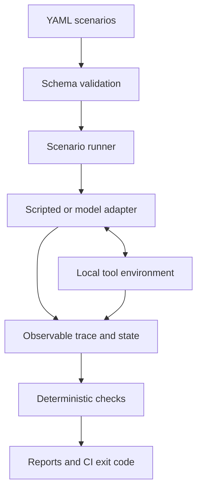

# Agent Anvil

**Regression testing for tool-using AI agents.**

[](https://github.com/HetRachhadiya11/agent-anvil/actions/workflows/test.yml)
[](pyproject.toml)
[](LICENSE)

Agent Anvil checks an agent's tool calls, execution order and resulting state
alongside its final response. It turns YAML scenarios into repeatable tests,
records observable events, and produces reports that can gate a CI build.

Built and maintained by **[Het Rachhadiya](docs/MAINTAINER.md)**.

[Explore my portfolio: analytics, Shubhlam and research](https://github.com/HetRachhadiya11) ·
[ORCID research record](https://orcid.org/0009-0008-9577-2906)

[Quick start](#quick-start) · [Architecture](docs/ARCHITECTURE.md) ·
[Verification](VERIFICATION.md) · [Research protocol](RESEARCH_PROTOCOL.md) ·
[Contributing](CONTRIBUTING.md)

## What it checks

| Question | Checks available |
| --- | --- |
| Did the agent use the right tools? | Required and forbidden calls, argument values and call limits |
| Did it follow the correct sequence? | Call ordering, preconditions and tool results |
| Did it leave the expected state? | Assertions over the final environment state |
| Did it return a valid response? | Response presence and configured response assertions |
| Can a regression be reproduced? | Versioned scenarios, traces, run manifests and failure groups |

The local tool environment uses in-memory state. The included smoke run needs
no API key and does not operate on live business systems.

## Quick start

Requires Python 3.10 or newer. Run these commands in a macOS or Linux shell:

```bash
git clone https://github.com/HetRachhadiya11/agent-anvil.git
cd agent-anvil
python -m venv .venv
source .venv/bin/activate
python -m pip install -e .

python -m agent_anvil.cli validate scenarios/smoke.yaml
python -m agent_anvil.cli run \
  --scenarios scenarios/smoke.yaml \
  --agent scripted \
  --output artifacts/smoke \
  --ci-gate
```

On Windows PowerShell, activate the environment with
`.\.venv\Scripts\Activate.ps1`, and put the `run` command on one line.

The smoke suite contains **five deterministic scenarios**. A successful run
exits with code `0` and writes `artifacts/smoke/report.md`. With `--ci-gate`,
any failed hybrid evaluation makes the command exit with code `1`.

| Output | Purpose |
| --- | --- |
| `report.md` | Readable evaluation summary and grouped failures |
| `results.json` | Per-run results and individual assertion outcomes |
| `summary.json` and `summary.csv` | Aggregated evaluation views |
| `failure_groups.json` | Repeated failures grouped by assertion and context |
| `run_manifest.json` | Run configuration, runtime and artifact locations |
| `traces/` | Versioned JSON traces and JSONL event records |

## How it works



Four evaluation views are computed over the same execution:

| View | Scope |
| --- | --- |
| Response-only | Final response is present and has no explicit runtime error marker |
| Environment-state | Final-state assertions |
| Trace-only | Tool use, arguments, ordering, results and policy assertions |
| Hybrid | Response, state and trace assertions must all pass |

These views are paired measurements of one run. The analysis reports paired
disagreements and per-check detections; the views are not independent samples.
See the [module map and extension points](docs/ARCHITECTURE.md).

## Engineering and verification

The [GitHub Actions workflow](.github/workflows/test.yml) runs on Python 3.10,
3.11 and 3.12. It checks linting, generates scenarios and schemas, runs tests
with an **80% minimum coverage gate**, executes smoke scenarios and builds the
Python package.

The [version 0.2.0 verification record](VERIFICATION.md) documents:

- **14 passing automated tests** and **81% combined statement/branch coverage**;
- **5 passing smoke scenarios**;
- schema validation of **100 benchmark scenarios across five suites**;
- successful wheel and source-distribution builds.

To run the development checks locally, follow [CONTRIBUTING.md](CONTRIBUTING.md).

## Research scope

Agent Anvil is research software with an implemented scripted adapter and an
OpenAI Responses API adapter. The verification record covers functional tests
and controlled fixtures. Provider-backed evaluation of real models is separate
work; the current results do not establish model rankings, real-world failure
rates or production readiness.

The [research protocol](RESEARCH_PROTOCOL.md) defines the optional empirical
study. [Manuscript materials](paper/README.md), [citation metadata](CITATION.cff)
and [research status](SUBMISSION_STATUS.md) are available in the repository.

### Optional provider-backed runs

Install the optional adapter, configure `OPENAI_API_KEY` in your execution
environment, and replace `MODEL_ID` with a model available to your account.
These runs make external API calls and can incur usage charges.

```bash
python -m pip install -e '.[openai]'
python -m agent_anvil.cli run \
  --scenarios scenarios/benchmark_v1.yaml \
  --agent openai \
  --model MODEL_ID \
  --repetitions 3 \
  --output artifacts/model-study
```

An optional `--judge-model JUDGE_MODEL_ID` adds a response-only model judge.
Agent Anvil records observable responses, tool events and state snapshots. It
does not request or store hidden chain-of-thought.

## Contributing and security

Bug reports, test cases and documentation improvements are welcome. Read the
[contribution guide](CONTRIBUTING.md) before proposing a change.

Trace artifacts can contain sensitive content. The package redacts common
credential patterns and applies restrictive POSIX artifact permissions, but
these controls do not identify every sensitive value. Use synthetic or
explicitly authorised data and follow the [security policy](SECURITY.md).

## License

[Apache License 2.0](LICENSE).
